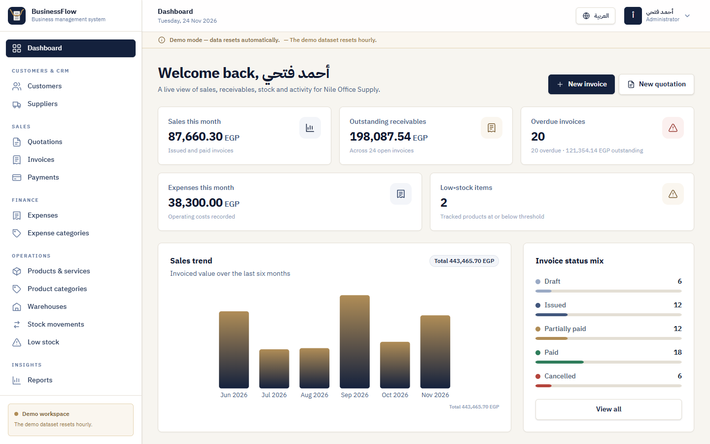
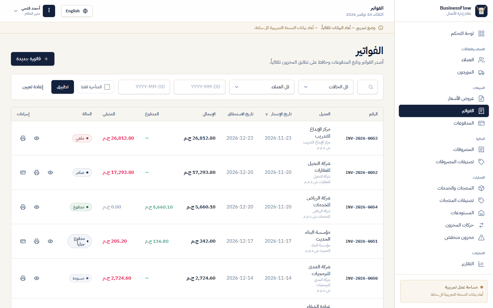
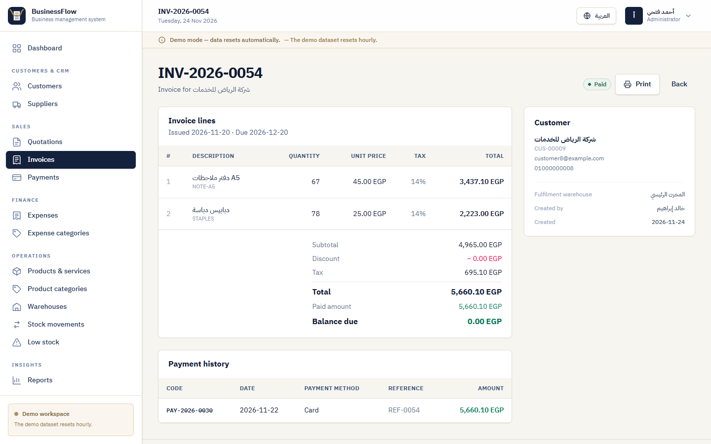
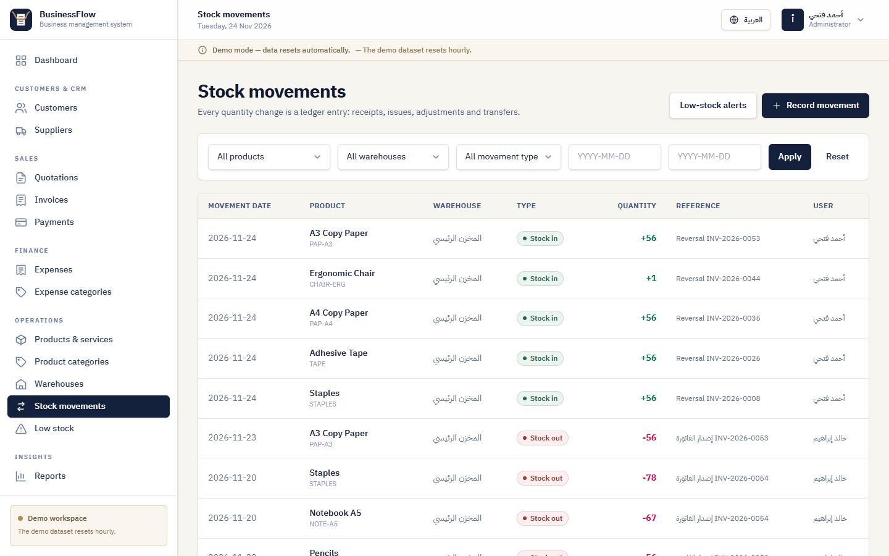
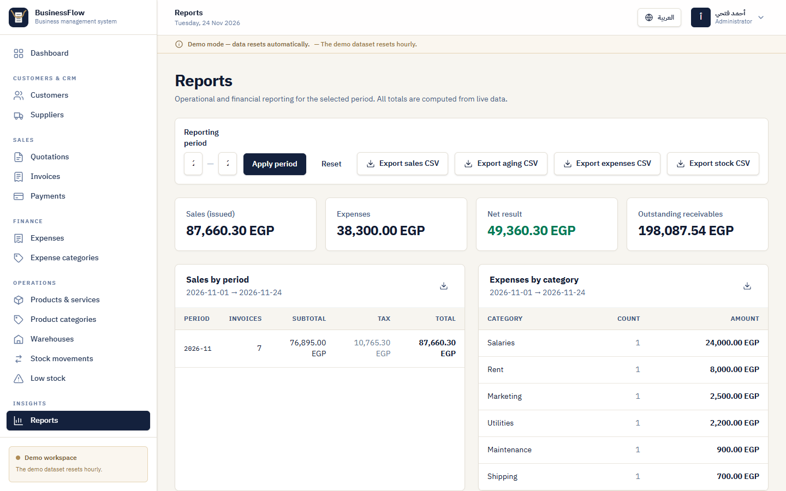
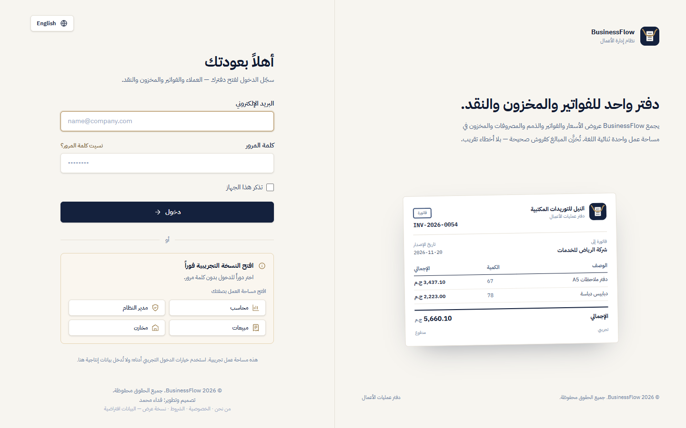
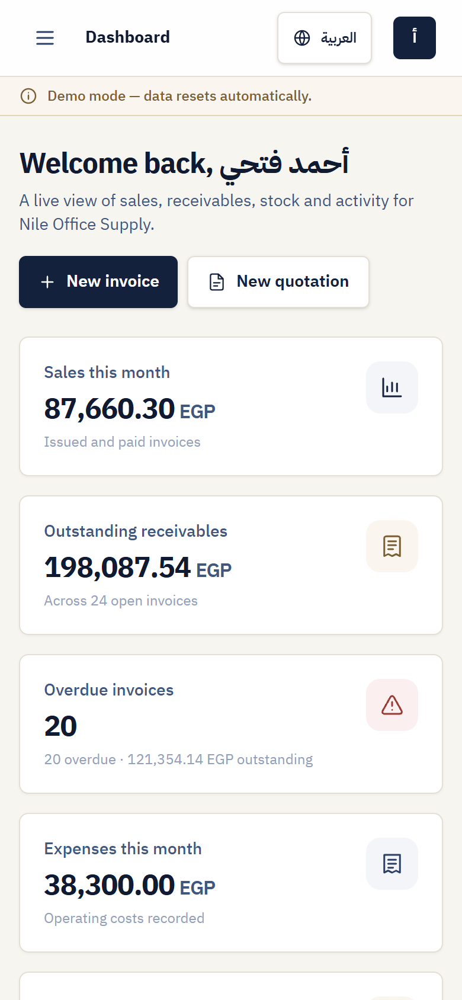
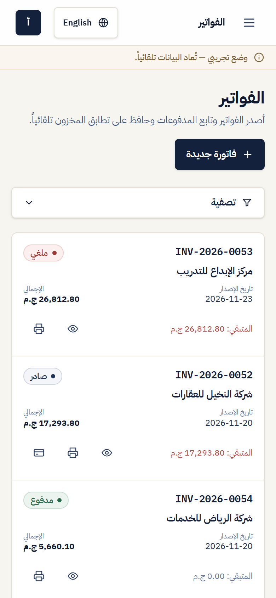

# BusinessFlow

Business management for small companies: invoices, quotations, payments, stock and reports in one place.



BusinessFlow is a single operations ledger for a trading or services company. It covers the full cycle from quotation to invoice to payment, keeps stock in sync with every issued invoice, and turns the data into receivables, sales and inventory reports.

The demo company is **Al-Nile Office Supplies**, a fictional Cairo distributor with six months of sample customers, products, invoices and expenses.

The interface is Arabic-first (right-to-left) with a complete English version.

## Highlights

- **Quotations → invoices:** multi-line documents with per-line tax, a controlled status flow and one-click conversion of an accepted quotation into an invoice.
- **Invoices and payments:** draft → issued → partially paid → paid, cancellation with a recorded reason that reverses stock, and an A4 print layout.
- **Inventory:** multiple warehouses, a signed stock ledger (in / out / adjustment / transfer) and low-stock alerts.
- **CRM and suppliers:** companies and individuals, contacts, customer statements and linked expenses.
- **Reports:** sales by period, customer and product, receivables aging (0–30 / 31–60 / 61–90 / 90+), expenses and stock valuation, with formula-safe CSV export.
- **Roles and permissions:** Admin, Accountant, Sales and Warehouse, with an editable permission matrix and action-level checks.
- **Activity log:** document, status, sign-in and permission events with the changed fields.
- **Money is exact:** amounts are stored as whole piasters (integers), never floating point.

## Screenshots

**Invoices list** · Arabic



**Invoice detail** · English



**Stock movements** · English



**Reports** · English



**Sign-in with one-click demo roles** · Arabic



**On mobile** (English and Arabic)

<p>
  
  
</p>

## Tech stack

| Layer | Technology |
| --- | --- |
| Backend | PHP 8.4, Laravel 13 |
| Frontend | Blade, Tailwind CSS 4, Alpine.js 3 (CSP build), Vite 8 |
| Database | SQLite |
| Fonts | IBM Plex Sans Arabic and IBM Plex Mono, self-hosted |
| Tests | PHPUnit feature tests |

No CDNs, trackers or analytics. All fonts and assets are self-hosted.

## Running locally

Requirements: PHP 8.3+ with the `pdo_sqlite`, `sqlite3`, `mbstring`, `fileinfo` and `zip` extensions, Composer 2, Node.js 24 and npm.

```bash
composer install
cp .env.example .env
php artisan key:generate
touch database/database.sqlite
php artisan migrate --seed
php artisan storage:link
npm install
npm run build
php artisan serve
```

Then open http://127.0.0.1:8000.

Full setup notes are in [INSTALL.md](INSTALL.md).

## Demo access

The sign-in page has **Try the demo** buttons for Admin, Accountant, Sales and Warehouse. One click, no password. The demo workspace resets every hour (`php artisan demo:reset`). Set `DEMO_MODE=false` in `.env` to remove the demo entry points.

All names, phone numbers, emails and records in the demo are fictional sample data.

## Tests

```bash
php artisan test
```

87 automated tests, all passing at the time of publishing. Details in [TESTING.md](TESTING.md).

## Documentation

- [INSTALL.md](INSTALL.md)
- [TESTING.md](TESTING.md)
- [SECURITY.md](SECURITY.md)
- [ROADMAP.md](ROADMAP.md)
- [docs/ARCHITECTURE.md](docs/ARCHITECTURE.md)
- [docs/DECISIONS.md](docs/DECISIONS.md)
- [THIRD-PARTY-NOTICES.md](THIRD-PARTY-NOTICES.md)

## License

Copyright © 2026 Fedaa Mohamed. All rights reserved.

This repository is public so the code can be reviewed. It is **not open source**: no permission is granted to use, copy, modify, distribute or sell any part of it without prior written permission. See [LICENSE](LICENSE). Third-party libraries and fonts keep their own licences, listed in [THIRD-PARTY-NOTICES.md](THIRD-PARTY-NOTICES.md).

---

Designed & built by [Fedaa Mohamed](https://fedaamohamed.com).
